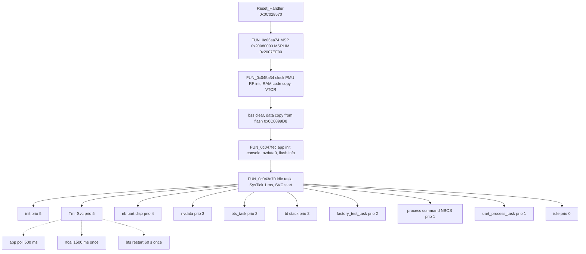
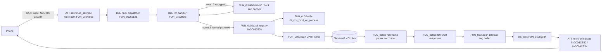

# BLE_219 firmware architecture

Firmware: `BLE_219` (`firmware/ble/BLE_219.bin`, sha256 `1879c3e5…abaa45c0`, 403 044 bytes), the BLE/BT module of the owner's Segway-Ninebot scooter. Bestechnic BES SoC, Cortex-M33 class (Thumb-2, Secure-state veneers present). This document is an engineering map for maintenance and design review. It describes mechanisms only.

Conventions
- Addresses are image addresses. Image base `0x0C028000`, so file offset = address - `0x0C028000`. RAM is `0x20000000`..`0x20080000`.
- `FUN_xxxxxxxx` is a Ghidra auto name. Names from `annotations/ble/functions` are used where present. A name in the form `0x0C….` marks a function that was disassembled with capstone because Ghidra did not recover it.
- Confidence is given per section: **H** high (direct code evidence), **M** medium (strong inference), **L** low (guess to verify).
- Secret values (keys, passwords, serial-number values) are not reproduced. They are referenced by address only.

Build identity strings (from the image): application `1.9.175((ZT3PRO_V0.2.1.8_20240815w33_hotfix)…)` built 2024-08-15 (`0x0C084334`); BT stack `6.7.2081((BT100_20240808w32_zt3pro_v218_hotfix)…)` (`0x0C084664`); controller `BT100V1.0.0.8` (`0x0C07F188`); ROM/patch metadata with commit IDs (`0x0C0779xx`).

Coverage caveats
- The export lists 1769 functions. 844 carry annotations. About 62 % of the code span is covered by function bodies.
- 38 gaps of 512 bytes or more (about 132 KB) have no function entries. They are mostly data, the RAM-resident block copied at boot, and some routines Ghidra did not split out. Examples are the tail of the BLE command handler at `0x0C029FE2..0x0C02A2E0` and the security-manager region around `0x0C0505F0..0x0C052AD4`.

---

## 1. Boot flow, vector table and memory map (H)

### 1.1 Reset sequence

`Reset_Handler` at `0x0C028570` (58 bytes) runs in this order:

| Step | Call | Effect (evidence) |
|---|---|---|
| 1 | `FUN_0c03aa74` (`startup_init_main_stack`) | Masks IRQs. Sets MSP = `0x20080000` and MSPLIM = `0x2007EF00`. Selects thread mode and privileged stack. |
| 2 | `FUN_0c045a34` | (a) `bes_sysreg_select_mode1` (`0x0C0410E8`): low 3 bits of `0x4008005C` and `0x400800B4` set to 1. (b) memcpy 0x3390 bytes from `0x0C086648` to `0x200001C0` (RAM-resident code and data). (c) memset 0x838 bytes at `0x20003550`. (d) `FUN_0c03ab80`: clock, PMU, IOMUX and cache init, plus RAM-patch thunks. (e) `NVIC_InitVectors` (`0x0C046F24`): copies the flash vector table to `0x20000000` and sets VTOR. (f) `FUN_0c03a2a0` and `FUN_0c037d08`: analog-interface and RF register tables. (g) `bes_boot_magic_is_valid` (`0x0C041CBC`) checks `0x2000017C == 0x4F42494D` ("MIBO"). If that check returns 0, `FUN_0c03ab30` runs (FPU enable, divide-by-zero trap, fault handlers). Otherwise the function returns early. |
| 3 | `FUN_0c03aa8e` | Empty. |
| 4 | memset | `.bss` at `0x20004A18`, length `0x14B2C` (84 780 bytes), zeroed. |
| 5 | memcpy | `.data` at `0x20003D88` copied from flash `0x0C0899D8`, length `0xC8C`. |
| 6 | `FUN_0c045aac` | Empty. |
| 7 | `FUN_0c047fec` | Application init, described below. |
| 8 | `FUN_0c070204` | Post-scheduler fallback. It is not reached in normal operation. It calls the task-exit routine `FUN_0c035fc0`, which prints `task %s exit` and parks. |

`FUN_0c047fec` (application init) runs these steps in order:
1. `FUN_0c0459d4(0)`, `FUN_0c035d30`: opens the console (`/dev/uart0`, which the string table also links to `/dev/uart1`) and prints `console initialzed at %s`.
2. `FUN_0c041d50`: opens `/dev/nvdata0`. Failure is logged as `Invalid nvdata0 !`.
3. `FUN_0c04014c(1)`, `FUN_0c036394(1)`, `FUN_0c0459fc`: hardware and flash setup. `FUN_0c0459fc` prints the chip flash size and the reset raw reason.
4. `thunk_FUN_0c0354e8`: creates the NBOS shell task `process command` (see §2).
5. `FUN_0c0286e0`: application-layer init.
6. `FUN_0c043d3c`: creates task `init` (0x400 words, priority 5, entry `LAB_0c047f8c`).
7. `FUN_0c043e70`: creates the idle task (static memory), sets up SysTick and starts the first task. It does not return.

### 1.2 Boot tags and upgrade request

| Address | Use | Evidence |
|---|---|---|
| `0x2000017C` | Boot magic word. `0x4F42494D` ("MIBO") means normal boot. | `FUN_0c041CBC`, `FUN_0c041CD4`. |
| `0x2000017C` | `0x61447055` ("UpDa") is an upgrade request. `FUN_0c041D28(1)` writes it, `FUN_0c041D28(0)` clears it. | `FUN_0c041D28` (M for the exact reset path). |
| `0x2000018C` | Flag word `0x5A465459`, armed and tested by `FUN_0c041CF8` and `FUN_0c041D10`. | Use not determined (L). |

Boot-time image checks are in the gap region near `0x0C041C14..0x0C041C4E`. The strings are `app verify error`, `appstart done`, `app img error`, `boot tag: 0x%x(%s)`, and the boot-tag names `init`, `update`, `unknown`. The application-check path `0x0C047124..0x0C047166` prints `Valid application(size: %lu)` or `Invalid application`. It uses `bes_image_format_name` (`0x0C034818`). See §7.

### 1.3 Vector table (H)

The vector table is at file offset 0x400 (`0x0C028400`). It is copied to SRAM `0x20000000` at boot.

| Vector | Target | Notes |
|---|---|---|
| 0 | initial SP | Not a code address. |
| 1 Reset | `0x0C028570` | `Reset_Handler`. |
| 2 NMI | `0x0C046EE8` | Spins forever. |
| 3 HardFault | `0x0C035FA8` | Dumps fault state to the trace UART and halts. |
| 4 MemManage, 5 BusFault, 6 UsageFault, 12 DebugMon, 13 | `0x0C035F90` | `Default_Handler` (fault dump, `0x0C035F90`). |
| 7 SecureFault, 8–10 | 0 | Unused. |
| 11 SVC | `0x0C03F910` | `rtos_svc_handler`, starts the first task. |
| 14 PendSV | `0x0C03F8A0` | Context switch. |
| 15 SysTick | `0x0C03F674` | 1 ms tick, calls `xTaskIncrementTick`. |
| 19 (IRQ3) | `0x0C04555C` | DMA controller 0 (`0x40120000`). |
| 20 (IRQ4) | `0x0C04556C` | DMA controller 1 (`0x40130000`). |
| 33 (IRQ17) | `0x0C0467B8` | Instance-based ISR, per-instance struct at `0x2000F510`. |
| 34 (IRQ18) | `0x0C0467C4` | Same handler family, struct at `0x2000F514`. |
| 42 (IRQ26) | `0x0C0467D0` | Same family, struct at `0x2000F534`. |
| 58 (IRQ42) | `0x0C04533C` | Calls `FUN_0c038730`, then `xQueueGiveFromISR` (`0x0C042F38`). Struct at `0x2000F574`. |
| all other IRQ slots | `0x0C046F0C` | `Default_Handler`. Logs `Unexpected interrupt %d occur` with the IPSR-derived number. |

Interrupt callbacks for other IRQs are registered at runtime in the IRQ table at `0x2000F4CC` (`FUN_0c046F54` stores and enables, `FUN_0c046F7C` disables).

### 1.4 Memory map (H unless noted)

| Region | Address range | Content |
|---|---|---|
| Flash image | `0x0C028000`..`0x0C08A724` | Header 0x400, vectors `0x0C028400`, code, rodata and strings. |
| RAM-resident code/data | `0x0C086648` (flash) → `0x200001C0`..`0x20003550` | 0x3390 bytes copied at boot. |
| Zeroed block | `0x20003550`..`0x20003D88` | 0x838 bytes. |
| `.data` | `0x20003D88`..`0x20004A18` | Source flash `0x0C0899D8`, 0xC8C bytes. Includes the GATT database at `0x20004348`. |
| `.bss` | `0x20004A18`..`0x20019544` | 0x14B2C bytes. |
| Heap (newlib `sbrk`) | `0x20019544`..`0x2007EF00` | Break variable `0x20003F94`. Growth fails above `0x2007EF00`. |
| Stack | top `0x20080000`, limit `0x2007EF00` | MSP stack. Idle task stack is static at `0x2000C72C` (0x100 words). |

Selected fixed RAM objects (addresses are stable across the image):
- `0x20004348`: GATT database (§5).
- `0x200042F8`: BLE state object (`ble_get_state_ptr_42f8`).
- `0x20004980`: vehicle serial-number buffer, 16 bytes (§6).
- `0x20008FE4`: password candidate table, 3 × 17 bytes (§6).
- `0x200092EC`: session state byte (§6).
- `0x200092F0`: decrypted or plaintext working buffer.
- `0x200093F4`: 16-byte seed value (§6).
- `0x20009450`: active password, 16 bytes (§6).
- `0x20009480`: pointer to the BLE-side command registry (§4).
- `0x20009D10`, `0x20003DB8`: UART dispatcher context. `0x20003DB8` is channel 0.
- `0x2000A638`: GPIO per-pin handler table.
- `0x2000F4CC`: IRQ callback table.
- `0x2000FCB8`, `0x2000FCE4`, `0x2000FCF8`: ATT database pointer, ATT packet handler, ATT handler list.
- `0x20019314`: BLE hook table, dispatched by `FUN_0c06c138`.

---

## 2. RTOS and thread structure (H for identity and tasks; M for queue and timer usage)

### 2.1 Kernel

The kernel is FreeRTOS (queue.c, list.c, tasks.c, timers, stream and message buffers, event groups, plus the Cortex-M port). The port is in `0x0C03F600`..`0x0C03F910`.
- `vPortSetupTimerInterrupt` (`0x0C03F600`): SysTick at 1 ms. LOAD = clock/1000 − 1, CTRL = ENABLE|TICKINT.
- Critical sections use BASEPRI. `FUN_0c03f874` raises BASEPRI to `0x40` and returns the previous value. `FUN_0c03f88c` restores it. Nesting is in `0x20003EC4`.
- `rtos_start_first_task` (`0x0C03F850`): resets MSP from the vector table, enables interrupts and issues SVC #2. `SVC_Handler` then switches to the first task using PSP.
- Context switch is PendSV (`0x0C03F8A0`), requested by `rtos_pendsv_trigger` (`0x0C03F628`).
- Tick: `SysTick_Handler` (`0x0C03F674`) calls `xTaskIncrementTick` (`FUN_0c043f48`) under BASEPRI and pends PendSV if a switch is needed.
- Priorities follow FreeRTOS convention: higher number runs first. The idle task is priority 0.

### 2.2 Tasks

Creation calls resolve as follows. `FUN_0c043d3c` is `xTaskCreate`. `FUN_0c043cfc` is `xTaskCreateStatic`.

| Task | Created by | Entry | Stack (words) | Priority | Notes |
|---|---|---|---|---|---|
| (idle) | `FUN_0c043e70` → `vApplicationGetIdleTaskMemory` (`FUN_0c042800`) | — | 0x100 (static, at `0x2000C72C`) | 0 | TCB at `0x2000CB2C`. |
| `Tmr Svc` (timer service) | `FUN_0c044c2c` (xTaskCreateStatic) | `0x0C044EE8` (`prvTimerTask`) | 0x400 | 5 | Command queue from `FUN_0c044aa4`, 8 items × 16 bytes. |
| `init` | `FUN_0c047fec` (xTaskCreate) | `LAB_0c047F8C` | 0x400 | 5 | Created before the scheduler starts. |
| `process command` (NBOS shell) | `FUN_0c0354e8` (xTaskCreateStatic) | `LAB_0c034F0C` | 0x200 | 1 | Creates its own queue (`FUN_0c042ba0`). Prompt `NBOS >`. |
| `factory_test_task` | `FUN_0c02d554` (xTaskCreate) | `LAB_0c02D1F4` | 0x400 | 2 | Opens `/dev/gpio`, takes the UART channel fd, then delays 10 ticks in a loop. |
| `adc process` | `FUN_0c02d554` | `LAB_0c02D224` | 0x200 | 2 | Factory ADC path. |
| `uart_process_task` | `FUN_0c02d554` | `0x0C02D359` | 0x200 | 1 | Factory single-wire UART test path (M). |
| `nvdata` | `FUN_0c02d724` (xTaskCreateStatic) | `0x0C02DC51` (`FUN_0c02dc50`) | 0x100 | 3 | Command queue of 5 items × 4 bytes (`FUN_0c042ba0`). |
| `nb uart disp` | `FUN_0c02e420` (xTaskCreateStatic) | `0x0C02EB61` (`FUN_0c02eb60`) | 0x200 | 4 | UART dispatcher for `/dev/uart2`. Two 0x120-byte stream buffers. |
| `bts_task` | `FUN_0c059a40` (xTaskCreateStatic) | `0x0C0599D5` (`FUN_0c0599d4`) | 0x400 | 2 | Event loop for BLE/BTstack messages (§2.4). |
| `bt stack` | `FUN_0c05b6cc` (xTaskCreateStatic) | `0x0C05B678` | 0x400 | 2 | BTstack run loop and controller init (§2.4). |

### 2.3 Queues, buffers, events and memory

| Object | Created | Shape | Use |
|---|---|---|---|
| Queue | `FUN_0c042ba0` at `FUN_0c02d724` | 5 × 4 bytes | `nvdata` task commands. |
| Queue | `FUN_0c042ba0` at `FUN_0c0355c8` | 0x20 × 1 byte | Unnamed (L). |
| Queue | `FUN_0c042ba0` at `FUN_0c044aa4` | 8 × 0x10 | Timer service command queue. |
| Semaphore | `FUN_0c042ba0` at `FUN_0c045250` | 1, binary | Unnamed (L). |
| Stream buffers | `FUN_0c043498` at `FUN_0c02e420` | 2 × 0x120, trigger 1 | UART dispatcher RX and TX. |
| Stream buffer | `FUN_0c043498` at `FUN_0c04542c` | 0x1400 | "Failed to open hci intersys" path (HCI transport buffer). |
| Event groups | `xEventGroupCreateStatic` (`FUN_0c04281C`) at `FUN_0c047F70`, `FUN_0c048260` | — | `posix_event` at `0x2000F65C` and the select event at `0x2000F6D4`. |
| Heap | newlib `malloc` (thunk `0x0C07097C`, free `0x0C07098C`) on `sbrk` | — | Heap base is the end of `.bss`. |

Software timers (all created by `FUN_0c044c7c`, `xTimerCreate`):

| Timer | Created at | Period | Type | Callback | Purpose |
|---|---|---|---|---|---|
| `app poll timer` | `FUN_0c0297b0` | 500 ms | auto-reload | `0x0C028C94` | Application periodic state: VCU power state, battery-level cycle (every 15 min), unlock-state logging. |
| `rfcal_timer` | `FUN_0c03be8c` | 1500 ms | one-shot | `0x0C03BE8D` | RF calibration step. |
| `bts restart timer` | `FUN_0c059180` | 60 000 ms | one-shot | `0x0C0591CC` | Restarts the BT service. |
| (one-shot BTstack timer) | `FUN_0c02c0b8` (`app_req_timeout_timer_start`) | arbitrary ms | one-shot | `0x0C02C090` | Request timeout. |
| (500 ms deferred op) | `FUN_0c05cb08` | 500 ms | one-shot | — | Deferred operation queue (L). |

### 2.4 BLE and BT threads

`bt stack` (entry `0x0C05B678`, disassembled): the entry is a tail jump to `0x0C065AE0`, which loads a function pointer from RAM `0x200190B0` and jumps to its `+0x20` slot. The BTstack and controller main loop is therefore installed at run time (M). The BTstack initialisation is `FUN_0c05b67c`, called from `FUN_0c0592a4`. It calls `btstack_run_loop_init` (`0x0C065AEC`), `bthost_tlv_get_instance`, `ll_env_init` (`0x0C066DFC`), `bthost_link_key_db_tlv_get_instance` (`0x0C04ADE0`) and `le_device_db_tlv_configure` (`0x0C04F034`).

`bts_task` (`FUN_0c0599d4`): feeds the watchdog (`hal_wdt_task_checkin`) and waits on its message queue for up to 100 ms (`FUN_0c042858`). It then calls `FUN_0c05af1c`, `ble_ring_dispatch_pending` (`0x0C048B00`) and `FUN_0c059948`. A registered hook at `0x20014608` runs after that. Messages come from the ring buffers written by `FUN_0c05ae14` (§5, §4).

### 2.5 Thread and data-flow diagram

---

## 3. Code module map (M overall)

Module boundaries come from the source-file strings, annotation categories and name prefixes. Address ranges are approximate. The "entry" column gives the most useful starting function.

| Module | Address range (approx.) | Entry or anchor functions | Notes |
|---|---|---|---|
| Startup and vectors | `0x0C028400`..`0x0C028790`, `0x0C03AA3C`..`0x0C03AB80`, `0x0C045A34`..`0x0C047FEC` | `Reset_Handler` `0x0C028570`, `FUN_0c045a34`, `FUN_0c047fec` | H |
| App layer (VCU bridge, BLE app, crypto glue, nvdata, UART dispatcher) | `0x0C0285EC`..`0x0C02E7D8` | IAP `0x0C0285EC`, BLE RX `0x0C029DF8`, VCU command `0x0C02A484`, VCU responses `0x0C02B480`, frame send `0x0C02C124`, router `0x0C02C1E8`, nvdata `0x0C02D604`, `FUN_0c02dea8`, dispatcher `0x0C02E420`, parser `0x0C02E7D8` | H for the named entries |
| HAL peripherals | `0x0C02ECD8`..`0x0C041B60`, `0x0C0401B0`..`0x0C040290` (analog IF), `0x0C0410E8` | GPIO ISR `0x0C02FEEC`, I2C ISR `0x0C0302F4`, IPC ISR `0x0C0314F0`, `hal_spi` `0x0C031D78`, `hal_uart` `0x0C033D18`, `hal_wdt` `0x0C0342D4` | M |
| Flash drivers | `0x0C087394`..`0x0C089492` (NOR), `0x0C0875A8`..`0x0C087A0C` (IP controller), `0x0C0459FC` | `norflash_build_protect_table` `0x0C087A34`, `norflash_wait_busy_or_suspend` `0x0C0883F0`, `norflaship_*` | H |
| RTOS (FreeRTOS) | `0x0C03F600`..`0x0C03F910`, `0x0C0427F0`..`0x0C044C7C`, `0x0C043498`..`0x0C043658`, timers `0x0C044AA4`..`0x0C044EE8` | `FUN_0c043e70`, `FUN_0c043d3c`, `FUN_0c043cfc`, `FUN_0c043f48` | H |
| newlib libc | `0x0C06F450`..`0x0C073ACC`, `0x0C0701F8`, `0x0C0702F8` (getopt), `0x0C071478`/`0x0C0714D4` (rand), `0x0C071790` (strtok), `0x0C072F3C` (`_printf_i`), `0x0C07323C` (`_scanf_i`), `0x0C0707E8` (gmtime), `0x0C0709BC` (memcpy), `0x0C070A0A` (memset) | `FUN_0c071478`, `FUN_0c0714d4` | H |
| SEGGER RTT | `0x0C03F934`..`0x0C03F97C` | `segger_rtt_write_*` | M |
| BES controller and ROM patches | `0x0C03AC8C`..`0x0C03ECC8` (`bt_drv_*` RF init, ROM patch table `0x0C03CEC8`), `0x0C05D48C`..`0x0C05D4A4` (ROM pointer tables), `0x0C073AD0`..`0x0C073CC0` (RAM-patch thunks), `0x0C07C04C`..`0x0C07DE3A` (ROM patch functions for `ld_`/`lld_`/`lm_`/`sch_`/`em_`), `0x0C07D840`..`0x0C07DE30` (flash-alias patch thunks `a00xxxxx`) | `bt_drv_rf_init` `0x0C03CDFC`, `bt_drv_rom_patch_apply_table` `0x0C03CEC8`, `ble_ram_patch_thunk_*` | M |
| BLE controller state and link table | `0x0C04F0A4`..`0x0C05D4A8` (`ble_ctrl_*`, `ble_slot_*`, `ble_state_*`, `ble_link_table_get_base` `0x0C059558`), `0x0C065DF8`..`0x0C06F448` (controller and link-layer code interleaved with L2CAP) | `ble_ctrl_store_keys_and_addrs` `0x0C04F0C8`, `ble_ctrl_clear_pairing_flags` `0x0C04F0A4`, `ll_env_init` `0x0C066DFC` | M |
| BTstack host, ATT and GATT | `0x0C04C6FC`..`0x0C04EB80` (att_db `0x0C04CDF0`, att_server `0x0C04DFB8`..`0x0C04EC18`, sdp/data elements `0x0C04C580`..`0x0C04CAB8`), `0x0C04ECC0`..`0x0C04F034` (`le_device_db_tlv`), `0x0C04AB90`..`0x0C04AEF8` (`bthost_link_key_db_tlv`) | `att_set_db` `0x0C04CDF0`, `FUN_0c04eb24` (ATT init), `att_iterator_fetch_next` `0x0C04CC74` | H |
| BTstack HID and advertising | `0x0C04AF00`..`0x0C04BC2C` (`hid_device.c`, `hid_report_*`), `0x0C0645EC`..`0x0C0645E0` (`ad_iterator_*`) | `hid_report_id_status` `0x0C04AF00` | M |
| BTstack core | `0x0C0653E0`..`0x0C06570C` (linked list, memory pool, ring buffer), `0x0C065884`..`0x0C065AEC` (run loop), `0x0C065B2C`..`0x0C065C24` (`bd_addr_*`, `co_*`) | `btstack_run_loop_embedded_*`, `btstack_ring_buffer_*` | H |
| HCI and L2CAP | `0x0C0661E8`..`0x0C06B048` (`hci.c`), `0x0C06C2E0` (`hci_transport_h4.c`), `0x0C06C7AC`..`0x0C06F078` (`l2cap.c`) | `hci_send_cmd` `0x0C067178`, `hci_event_handler` `0x0C068DA8`, `l2cap_send_signaling_packet` `0x0C06C7AC` | M |
| Security manager (SM) | roughly `0x0C0505F0`..`0x0C052AD4` (strings only) | strings `sm_sc_cmac_done`, `Persistent ER/IR not set` | L |
| Crypto (own and wolfSSL) | `0x0C02C3FC`..`0x0C02C454` (CRC-32), `0x0C036418` (TEA), `0x0C047644` (CRC-16), `0x0C047710`..`0x0C047F6A` (MD5), `0x0C048F3C`..`0x0C049288` (AES-128, CCM MIC), `0x0C0499F0`..`0x0C049A28` (SHA-1), `0x0C04A924`..`0x0C04A9A8` (mbedTLS SHA-1), `0x0C0496A8` (packet auth), `0x0C05B5C0`..`0x0C05C10C` (app KDF, ECC, GCM glue), wolfSSL `0x0C05D4AC`..`0x0C0644E0` (AES, GCM, ASN.1, ECC, SHA-256, HMAC, RNG, TFM bignum) | `FUN_0c0496a8`, `FUN_0c060be8` (KDF), `wc_AesGcmDecrypt` `0x0C05E2F0`, `wc_ecc_init` `0x0C060190` | H |
| Application UART and factory | `0x0C02C49C`..`0x0C02D554` (factory commands), `0x0C03DFAC`/`0x0C03DFF4` (VCO test), `0x0C0468B4`, `0x0C0469A0` | `FUN_0c02c49c`, `FUN_0c02cca8`, `FUN_0c02d358` | M |
| Firmware upgrade | `0x0C0285EC` (IAP), `0x0C0365A4`..`0x0C037A2C`, `0x0C0474B0`..`0x0C0475D4` | `FUN_0c0285ec`, `FUN_0c0369d8`, `FUN_0c037588`, `FUN_0c0474b0` | M |
| Apple Find My (ninebot_fmna) | `0x0C052EE4`..`0x0C055B90` (init `0x0C052EE4`, URL `0x0C054534`, debug CLI `0x0C055B90`), status `0x0C02A8F8` | `FUN_0c052ee4`, `FUN_0c02a8f8` | M |
| NBOS shell and diagnostics | `0x0C0354E8` (`process command`), `0x0C0356DC` (option parser), `0x0C035D0C` (console printf), `0x0C041E38` (version), `0x0C044B14`/`0x0C044CCC` (task and timer stats), `0x0C046D50` (heap stats), `0x0C048040` (fdinfo), `0x0C0360D4` (task monitor). Command table `0x0C073D64`..`0x0C073E6C`. | `FUN_0c0354e8` | H |
| Watchdog and assert | `0x0C0362BC` (`hal_wdt_task_checkin`), `0x0C071FFC` (assertion failed) | `FUN_0c0360d4` | M |
| Data and strings | `0x0C07DE3A`..`0x0C086648`, `0x0C08A374`..`0x0C08A5D0`, `0x0C086648`.. (RAM-resident source) | — | — |

---

## 4. UART protocol between the BLE module and the VCU (H for framing, M for command semantics)

### 4.1 Link

- The VCU link is `/dev/uart2`, channel 0 of the UART dispatcher (`FUN_0c02e420`). The dispatcher context is `0x20003DB8` (`uart_disp_get_channel_ctx`). The VCU link is serviced by `nb uart disp` (§2).
- `/dev/uart1` is used by the factory path, with the string `only UART1 support half duplex` (`0x0C0859A8`).
- The baud rate was not traced in this pass (L).

### 4.2 Frame formats (verified in `FUN_0c02e5a4` and `FUN_0c02e7d8`)

Standard frame, header `5A A5`:

| Offset | Field |
|---|---|
| 0 | `5A` |
| 1 | `A5` |
| 2 | LEN (data length, 0..255) |
| 3 | SRC |
| 4 | DEST |
| 5 | CMD |
| 6 | INDEX |
| 7 … 6+LEN | DATA |
| 7+LEN | CK_LO |
| 8+LEN | CK_HI |

Wire length is LEN+9. The checksum is `(~Σ bytes[2 .. 6+LEN]) & 0xFFFF`, stored little-endian. The sum includes the LEN byte, the four header attributes, and the data. The sender computes it in `FUN_0c02e5a4` and the receiver checks it in `FUN_0c02e7d8`.

Short frame, header `55 AA`:

| Offset | Field |
|---|---|
| 0, 1 | `55`, `AA` |
| 2 | LEN |
| 3 | DEST |
| 4 | CMD |
| 5 | INDEX |
| 6 … 5+LEN | DATA |
| 6+LEN, 7+LEN | checksum, low byte first |

This form has no SRC field, so SRC is implicitly 0. The checksum covers bytes `[2 .. 5+LEN]`. Wire length is LEN+8.

The router `FUN_0c02e7d8` scans the RX ring for `5A A5` or `55 AA`, checks that the length fits the buffered bytes, verifies the checksum, and dispatches on (SRC, DEST, CMD). Unmatched frames log `Uart dispatcher: not find chn(%d),src_id(%d),dest_id(%d),cmd(%d)`.

### 4.3 Dispatch tables (decoded from the image)

Table A, exact match on (SRC, DEST, CMD). Entries are 8 bytes at `0x0C073EC8`..`0x0C073EEC` (key word, handler):

| SRC | DEST | CMD | Handler | Meaning (evidence) |
|---|---|---|---|---|
| 0x3D | 0x23 | 0x41 | `FUN_0c02cca8` | Factory-side command; logs `index error` (L on the meaning). |
| 0x3D | 0x23 | 0x42 | `FUN_0c02c49c` | Factory and RF test commands (§9). |
| 0x3D | 0x23 | 0x01 | `FUN_0c02d128` | Wrapper that calls the FMNA status routine `FUN_0c02a8f8` (M). |
| 0x3D | 0x23 | 0x02 | `FUN_0c02d16c` | Wrapper that calls the FMNA status routine `FUN_0c02a8f8` (M). |
| 0x3D | 0x23 | 0x7E | `FUN_0c02d1b0` | Wrapper that calls `FUN_0c02b264` (MTU and token, §4.5). |

Table B, masked match on (DEST, CMD) with SRC ignored. Entries are 12 bytes at `0x0C073EF0`..`0x0C073FCC` (mask word, key word, handler):

| DEST | CMD | Handler | Meaning |
|---|---|---|---|
| 0x04, 0x0D, 0x0E, 0x0F | 0x07, 0x08, 0x09, 0x0A | `FUN_0c0285ec` | Firmware upgrade (IAP) receiver (§7). |
| DEST bits masked by 0x3E | any | `FUN_0c029f68` | Range-style masked entry (L). |
| DEST 0x04 | any | `FUN_0c02bd18` | Masked catch-all for the BLE module (L). |

### 4.4 Transmit paths

- BLE-originated frames to the VCU are built by `FUN_0c02c124(dir, src, dest, cmd, index, data)`. It fills a 256-byte frame buffer and calls `FUN_0c02e758`, which does `write()` on `/dev/uart2`, guarded by a semaphore with a 100 ms timeout. Typical call: `FUN_0c02c124(1, 4, 0x16, cmd, index, data)`. Here SRC = 0x04 (BLE module) and DEST = 0x16 (VCU). The length comes from the header, and the first argument is a direction or priority flag whose meaning is not confirmed.
- Replies to the phone are built by `FUN_0c02c338` (frame header `0x5A`). They are queued with `FUN_0c05ae14(type, len, buf)` into a BTstack ring buffer. Type 2 uses ring `0x20015538`, and type 3 is used for response frames. `bts_task` then sends them as ATT notifications (`att_prepare_handle_value_notification` `0x0C04CE50`, `att_prepare_handle_value_indication` `0x0C04CE84`).
- `FUN_0c02e5a4` is the dispatcher's own send path. It takes a block with a type character (`e` for the short form, anything else for the standard form), then the header fields, then the data. It logs `Uart dispatcher: send sem timeout` when it cannot get the send semaphore.

### 4.5 Main commands

Phone or app → BLE module (SRC 0x3E, DEST 0x04). These keys come from the BLE-side command registry at `0x0C082508`, which `FUN_0c02c1e8` walks. The registry is installed by `app_set_default_cfg_ptr` (`0x0C02A46C`).

| CMD | Handler | Evidence |
|---|---|---|
| 0x00 | `0x0C029E4C` | Registry entry. |
| 0x01, 0x02, 0x7E | `FUN_0c02b42c` → `FUN_0c02b264` (for 0x7E) | `FUN_0c02b264` handles link MTU and parameters (`mtu=%d`), checks a token CRC (`save token err!recv crc=…`) and stores the token through `FUN_0c05c8a8` into nvdata partition 2 record 0x1389 (§6.9, §8). |
| 0x07 … 0x0A | `0x0C02A724` (not recovered by Ghidra; in a gap) | Registry entries. Role not verified (L). |
| 0x58, 0x80 | `0x0C02A128` | Registry entries. CMD 0x58 is also seen as `act off` from the VCU. |
| 0x5B, 0x5C, 0x5D | `0x0C029FB0` | Registry entries. |
| 0x6F | `0x0C029EF8` | Registry entry. |

Phone command processor `bt_vcu_cmd_wr_process` (`FUN_0c02a484`) logs `src, dest, cmd, index`. It answers locally when DEST is 0x09 (for example `get ecu pn`, CMD 1, INDEX 0x28). Other requests are forwarded to the VCU.

VCU → BLE module (`FUN_0c02b480`, responses with SRC 0x16). The switch is on CMD, with the strings giving meanings:

| CMD | Meaning (evidence) |
|---|---|
| 0x58 | `act off`. |
| 0x5E | Command path that writes the 474-byte config block to nvdata partition 2 through `FUN_0c05b0a8` (§6.5). |
| 0x5F, 0x75 | `ver ack`. |
| 0x7A, 0x7B | Unlock status: `VCU unlock status is allow` or `disallow`. `Insufficient conditions of unlock` (index 3 or 4). |
| 0x51 | `Power off`. |
| 0x61, 0x1D | Auto-key and seat up or down. |
| 0x70, 0x71, 0x78, 0x79 | Acknowledgements (`unlock_app_unlock ack`, `unlock_auth_cb ack`, `unlock_app_bucket ack`, `unlock_app_lock ack`). |
| 0xE0 | `navi ack`. |
| 0x16 (src) with 0x66 | `ble_clear_pairinfo ack` (clears pairing info). |

BLE → VCU queries (`FUN_0c02c124`, SRC 0x04, DEST 0x16):

| CMD | INDEX | Use |
|---|---|---|
| 0x01 | 0x1C | VCU state (`vcu state is %04x`). |
| 0x01 | 0x10 | Read VCU serial number. |
| 0x16 | 0x66 | Clear pairing info. |
| 0x16 | 0x7A, 0x7B | Unlock state changes. |
| 0x02 | 0x78 | Status to VCU (from `FUN_0c02a8f8`). |
| 0x03 | 0x7D, 0x82, 0x86 | BT and find-me state (`FUN_0c029960`, `FUN_0c029230`, `FUN_0c0288dc`). |

`FUN_0c029960` (`bts_op_cmd_handle`) handles the `bts` operation codes and replies with `bts_send_packet_to_app`.

### 4.6 Confidence notes

- Framing and checksum: H. Both sides were read.
- Table A and B keys: H, decoded from the image.
- Command meanings: M. They come from strings and branches, not from a specification.

---

## 5. GATT database and data flow (H for database; M for the app route)

### 5.1 Installation

`FUN_0c059230` calls `FUN_0c04eb24(&DAT_20004348, 0x0C05ADA4, 0x0C05AFA4)`. That function:
- sets `DAT_2000FCB8` to the database through `att_set_db` (`0x0C04CDF0`), checking that the first byte is version `0x01`;
- sets the ATT read callback (`0x0C04E294`);
- registers the HCI event handler and other BTstack hooks;
- stores the write-path handler `FUN_0c04dfb8` at `0x2000FCCC`.

The second argument `0x0C05ADA4` is a callback. Its body (`FUN_0c05ada4`) holds the strings `Segway-Ninebot` and `KickScooter`, which are the advertised name candidates (M).

The database is in `.data` at RAM `0x20004348`. The flash source is `0x0C089F98` (file offset `0x61F98`). It has 72 records.

### 5.2 Record format (verified in `att_iterator_fetch_next`, `0x0C04CC74`)

Each record is:

| Offset | Size | Field |
|---|---|---|
| 0 | u16 | Record size. Zero terminates the table. |
| 2 | u16 | Flags. Bit `0x0200` means a 128-bit UUID. Bit `0x0100` marks a dynamic value, read through callbacks. Bit `0x0002` is read. Bit `0x0008` is write. Bit `0x0010` is notify. Bits 12..15 encode the security requirement, checked in `att_validate_security` (`0x0C04CBB4`). |
| 4 | u16 | Handle. |
| 6 | 2 or 16 | UUID. |
| 8 or 22 | rest | Value. |

### 5.3 Services and characteristics

Decoded from the database. Property letters: R read, W write, WNR write-without-response, N notify, I indicate.

| Service handle | Service UUID | Characteristics (decl handle, props, value handle, UUID) | Notes |
|---|---|---|---|
| 0x0001 | 0x1801 (Generic Attribute) | 0x0002 R, 0x0003, 0x2B2A (Database Hash) | Standard. |
| 0x0004 | 0x1804 (Tx Power) | 0x0005 RN, 0x0006, 0x2A07 (Tx Power Level). CCCD 0x0007 (writable). | Standard. |
| 0x0008 | `87290102-3C51-43B1-A1A9-11B9DC38478B` | Ten characteristics, 0x0009..0x001C. Each is `6AA5000n-6352-4D57-A7B4-003A416FBB0B`, read-only, dynamic, value handles 0x000A, 0x000C, …, 0x001C. | Vendor read-only status block (M). |
| 0x001D | 0xFD44 (Apple Find My) | Four characteristics: `4F860001..4F860004-943B-49EF-BED4-2F730304427A`, props WI, value handles 0x001F, 0x0022, 0x0025, 0x0028. CCCDs 0x0020, 0x0023, 0x0026, 0x0029. | Matches the Find My accessory UUID (M). §8. |
| 0x002D | `6E400001-B5A3-F393-E0A9-E50E24DCCA9E` (Nordic UART) | RX 0x002E WNRW, value 0x002F, UUID `6E400002…`. TX 0x0030 N, value 0x0031, UUID `6E400003…`. CCCD 0x0032. | Most likely the phone↔VCU bridge (M). |
| 0x0033 | `6E400001-0000-0000-006E-…` (NUS-derived) | RX 0x0034 WNRW (0x0035). 0x0036 WNRW (0x0037). TX 0x0038 N (0x0039, CCCD 0x003A). 0x003B WNRW (0x003C). 0x003D N (0x003E, CCCD 0x003F). | Second NUS-derived service with an ASCII-suffixed base (M). |
| 0x0040 | `6E400001-0000-0000-0070-…` (NUS-derived) | 0x0041 WNRW (0x0042). 0x0043 N (0x0044, CCCD 0x0045). | Third NUS-derived service (M). |
| 0x0046 | `61751276-FDD6-11ED-BE56-0242AC120002` | 0x0047 WNR (value 0x0048, UUID `99EA30E2-…`). 0x0049 RN (value 0x004A, UUID `7EE484EA-…`). CCCD 0x004B. | Vendor service (M). |

### 5.4 Data flow

Phone → VCU:
1. The phone writes to a write characteristic (for example NUS RX, value handle 0x002F). BTstack's ATT server (`att_server.c`, write path `FUN_0c04dfb8`) runs the handlers in the list at `0x2000FCF8`. Writes reach application code through the BLE hook dispatcher `FUN_0c06c138`, which calls hook entry 2 for each enabled channel index.
2. The application receive handler `FUN_0c029df8` receives the write. Its event code selects the path:
   - Event 2 (encrypted payload): `FUN_0c0496a8` checks the MIC and decrypts into `0x200092F0`. The key is chosen by the session state byte (§6.3). Two consecutive failures in states 2 or 4 disconnect the ACL (`decrypto error, disconnect ble acl`).
   - Event 3 (framed plaintext): frames with the `5A A5` header and `FE` marker are checked. `FUN_0c029D8C` and `FUN_0c029C18` parse them. `FUN_0c029CA8` counts them.
3. After successful authentication, `FUN_0c02c1e8` routes the frame. It consults the registry at `0x20009480` (initialised to `0x0C082508`). If no local handler claims the frame, it falls through to the local command processor `FUN_0c02a484` and to the UART sender `FUN_0c02e5a4` (the exact fall-through order is M).
4. `FUN_0c02e5a4` picks the channel context, writes the frame to `/dev/uart2`, and waits on its semaphore.

VCU → phone:
1. The VCU's frame arrives on `/dev/uart2`. `FUN_0c02e7d8` parses it and routes it through tables A and B (§4.3).
2. Handlers such as `FUN_0c02b480` (VCU responses) update the BLE state. Notifications to the phone are built with `FUN_0c02c338` and queued with `FUN_0c05ae14`.
3. `bts_task` (`FUN_0c0599d4`) drains the ring and posts ATT notifications or indications to the phone (`0x0C04CE50`, `0x0C04CE84`).

### 5.5 Registration gaps

`FUN_0c029df8` has no direct caller. Its address appears as a pointer in literal pools at `0x0C029798` and `0x0C0298D0`, inside the application region that Ghidra did not split into functions. The path from the GATT write into `FUN_0c029df8` therefore runs through indirect registration. Confidence M. Verify by tracing the hook table at `0x20019314`.

---

## 6. Access-control design (M)

This section describes the mechanisms. It does not reproduce any secret value.

### 6.1 Overview

The design has five parts:
1. A **vehicle serial number** (SN) from the VCU, held in RAM and checked for format.
2. A **password** that the phone must set or present. Candidate passwords are held in a table.
3. A **session state byte** that selects which key authenticates each packet.
4. **Packet protection** with an AES-128 CCM-style MIC and decryption (`FUN_0c0496a8`).
5. **Server-assisted key derivation** with labelled KDFs (`PairingSession`, `ServerSharedSecret`, `SerialNumberProtection`, `diversify`, `update`, `intermediate`, `connect`). This is an ECC and HMAC construction.

Bonding for BLE links is handled by BTstack (§6.8).

### 6.2 Vehicle serial number

- `ble_crypto_set_serial_number` (`FUN_0c05c888`) copies up to 16 bytes into `0x20004980`.
- The BLE module reads the SN from the VCU with a BLE → VCU query (CMD 0x01, INDEX 0x10, logged as `read vcu sn`). The reply is handled in `FUN_0c02b480`. It is validated with `FUN_0c02a2e0`, which returns 1 if the SN starts with a code from the ROM or RAM prefix list. The SN is then stored (`DEBUG:set sn`), or `not need set sn` is logged if it is already set. If the SN is invalid, the firmware logs `vehicle sn is invalid, use default sn` and uses a placeholder SN (`FUN_0c0292f0`, `FUN_0c029414`).
- Strings name the SN path `set vehicle sn to[%s]` and `set vehicle sn length error` (factory path, §9).

### 6.3 Session state (`0x200092EC`)

Values seen: 1, 2, 3, 4. Each write site is listed below. The full state machine was not recovered (M).

| Value | Set by | Meaning (inferred) | Key used for MIC |
|---|---|---|---|
| 1 | `FUN_0c02bdd0` (`ble_crypto_init`), `FUN_0c02a04c` path | Initial, SN-keyed | SN-derived block at `0x20009404` |
| 2 | `FUN_0c029df8`, after trial success or counter | Post-trial session | SN-derived block `0x20009404` |
| 3 | `FUN_0c02a02c` path, when no password is set | Default-password trial | Password block `0x20009450` |
| 4 | `cmd crypto set auth` (`0x0C0778…`, handler at `0x0C02A0C4`) | Authenticated session | Password block `0x20009450` |

In `FUN_0c029df8`, state 3 calls `FUN_0c02be44` for each failure. A trial counter at `0x2000944C` counts down, and when it reaches zero the state moves to 2 and `FUN_0c02bf20` runs.

### 6.4 Packet protection

- `FUN_0c0496a8` takes a key pointer, the data, the length and an output buffer. It expands an AES-128 key (`aes128_key_expansion` `0x0C048F3C`) and computes a CBC-MAC over CCM-style B0/B1 blocks (`ble_crypto_ccm_cbc_mac` `0x0C049288`, which emits a 4-byte MIC). It also runs AES-128 encryption (`aes128_encrypt_block` `0x0C048FD4`). The return value is `true` on a MIC mismatch.
- Keys are chosen by state as in §6.3. The key blocks are at `0x20009404`, `0x20009414` and `0x20009430`, with a SHA-1 context seeded from `0x200093F4` (§6.6).
- A failure in state 2 or 4 increments a failure counter. On the second failure the firmware logs `INFO:decrypto error, disconnect ble acl` and sets a disconnect flag (`FUN_0c0569a0`).

### 6.5 Password

- The password candidate table is at `0x20008FE4`: 3 records of 17 bytes. A record is considered valid when byte 0x11 of the record is `=`.
- `FUN_0c02be44` (`ble_crypto_try_default_pwd`) tries each valid candidate with `FUN_0c0496a8`. On success it sends a response with `FUN_0c02c1e8`. Each attempt logs `count[%d], faild[%d]`.
- Phone-side commands: `cmd crypto infor`, `cmd crypto set password` (16-byte value copied to `0x20009450`), `cmd crypto set auth` (state 4). Logs: `ble crypto set password: %d`, `already set password, auth`. The handlers are in the BLE command path near `0x0C02A02C`..`0x0C02A0EA`.
- The 474-byte block at `0x20008FE4` is written to nvdata partition 2 (mirror offset `0x1C5`) by `FUN_0c05b0a8`, called from the VCU path `FUN_0c02b480` (CMD 0x5E).
- A fixed ASCII code literal at `0x0C086084` is referenced by `FUN_0c0288dc`, which logs `REMOVE LIMIT SPD CODE` messages. Its value is withheld. See §6.10.

### 6.6 Labelled KDFs and server-assisted pairing

KDF `FUN_0c060be8(hash=6 (SHA-256), key, keylen, label, labellen, out, outlen)` is a counter-mode KDF using HMAC-SHA256 in the style of NIST SP 800-108 (M). Its callers use these labels:

| Label | Function | Inputs and output (evidence) |
|---|---|---|
| `update` | `FUN_0c05bcc0` | KDF over a 32-byte key, 32-byte output. |
| `intermediate` then `connect` | `FUN_0c05bce4` | Two KDF steps. Output 16 bytes. |
| `diversify` | `FUN_0c05bd30` | ECC (wolfSSL `wc_ecc_init`, point import `FUN_0c060ae4`, scalar operations `FUN_0c05b86c`/`FUN_0c05b724`), KDF over 0x48 bytes, then a 28-byte (0x1C) output. A 28-byte output implies P-224 (`SECP224R1` at `0x0C0861F8`). |
| `ServerSharedSecret` | `FUN_0c05be98` | KDF over 64 + 32 input bytes, 32-byte output. |
| `PairingSession` | `FUN_0c05bf00` | AES-128-GCM decrypt (`wc_AesGcmSetKey`, `wc_AesGcmDecrypt`) with a 16-byte tag. Key from KDF. |
| `SerialNumberProtection` | `FUN_0c05c088` | HMAC-SHA256 over the SN, keyed by a KDF output (`wc_HmacInit`, update and final). |

The callers of these labels are the record writers in §6.9, `FUN_0c053D04`, `FUN_0c053DA4` and `FUN_0c053A48`. Those writers store 32- and 48-byte derived values into nvdata partition 2.

The labels, the server-shared secret and the `PairingSession` GCM envelope indicate a server-assisted provisioning scheme. The exact message flow was not traced (M).

### 6.7 Crypto primitives by use

| Primitive | Implementation | Used for |
|---|---|---|
| AES-128 block and CCM MIC | Own code `0x0C048F3C`..`0x0C049288` | Packet MIC and encryption (`FUN_0c0496a8`). |
| AES-GCM | wolfSSL `0x0C05DBE0`..`0x0C05E2F0` | `PairingSession` decrypt. |
| AES (T-tables) | wolfSSL `wc_AesEncrypt` `0x0C05D4AC` | Under GCM. |
| SHA-1 (custom, seeded) | `0x0C049A28`, `0x0C0499F0` | SN-keyed block and session contexts (`FUN_0c02bdd0`). |
| SHA-1 (mbedTLS) | `0x0C04A924`, `0x0C04A9A8` | Unidentified caller (L). |
| SHA-256, HMAC-SHA256 | wolfSSL `0x0C060CE0`..`0x0C06100C` | KDF (`FUN_0c060be8`), `SerialNumberProtection`. |
| ECC and TFM bignum | wolfSSL `0x0C05E4E8`..`0x0C060BD4`, `0x0C061E14`..`0x0C062EA8`, `mp_*` `0x0C063FB8`..`0x0C0644E0` | `diversify` and ECC arithmetic. Curve tables for `SECP224R1` and `SECP256R1` (strings `0x0C0861F8`, `0x0C086204`). |
| TEA-CBC decrypt (32 rounds) | `0x0C036418` | Encrypted firmware upgrade modes (§7). |
| CRC-16/CCITT | `0x0C047644` | Upgrade framing checks. |
| CRC-32 | `0x0C02C3FC`, `0x0C02C454` | Upgrade image checksum. |
| MD5 | `0x0C047710`..`0x0C047EFC` | Upgrade file digest. |
| HSM TRNG | `0x0C033328` (`0x40008100` block), wrapper `0x0C04585C` | wolfSSL RNG seed (`0x0C061688`, `wc_RNG_TestSeed` at `0x0C061500`), controller random (`0x0C058250`, 6 bytes). |
| libc `rand()` | `0x0C0714D4`, seeded in `0x0C071478` | **The 16-byte value at `0x200093F4`** (see §6.10). |

### 6.8 Pairing and bonding (BTstack)

- Bonding and link-key storage are provided by `bthost_link_key_db_tlv` (`0x0C04AB90`..`0x0C04AEF8`, `put/get/delete_link_key`) and `le_device_db_tlv` (`0x0C04ECC0`..`0x0C04F034`). Both sit on a flash TLV store whose vtable is at `0x0C07FFFC` (three function pointers: `0x0C048DED`, `0x0C048CAD`, `0x0C048B71`, followed by text). The backing device for that vtable was not identified (M).
- SM strings show that LE Secure Connections and legacy pairing both exist: `Persistent ER not set with sm_set_er. Legacy Pairing LTK is not secure`, `Persistent IR not set with sm_set_ir`, `sm_sc_cmac_done in state %u`, `Please configure bthost_tlv to let BThost setup ER and IR keys`. The SM code was not recovered as functions (L).
- Controller-side key storage: `ble_ctrl_store_keys_and_addrs` (`0x0C04F0C8`), `ble_ctrl_clear_pairing_flags` (`0x0C04F0A4`), `ble_ctrl_set_key_dist_flags` (`0x0C04F848`).
- Clearing: the VCU command (src 0x16, cmd 0x16, index 0x66) clears pairing info. A debug command, `clear user bond info`, is in the NBOS path.
- ATT persistent CCCDs: `att_is_persistent_ccc` (`0x0C04DD40`).

### 6.9 Where persistent key material lives

| Location | Content (inferred unless noted) | Evidence |
|---|---|---|
| RAM `0x20004980` (16 B) | Vehicle SN (plain). | `FUN_0c05c888`. |
| RAM `0x20008FE4` (3 × 17 B, persisted as 474 B) | Password candidate table. | `FUN_0c02be44`, `FUN_0c05b0a8`. |
| RAM `0x20009404`..`0x20009430` | SN-derived block and SHA-1 contexts. | `FUN_0c02bdd0`. |
| RAM `0x200093F4` (16 B) | Seed (libc `rand()`, §6.10). | `FUN_0c05b5c0`. |
| RAM `0x20009450` (16 B) | Active password. | `cmd crypto set password`. |
| nvdata partition 2 (RAM mirror, flushed with ioctls 0x103, 0x104, 0x200) | Record IDs in §6.9.1. | `FUN_0c05b138`, `FUN_0c05b380`, `FUN_0c05b0a8`. |
| Flash TLV (vtable `0x0C07FFFC`) | Link keys and LE device DB (bonds). | §6.8. |
| `/dev/nvdata0` | General configuration (opened at init). | `FUN_0c041d50`. |
| `/dev/dflash`, `/dev/pflash` | Upgrade packet information and resume state. | §7. |

#### 6.9.1 Partition 2 record IDs

`FUN_0c05b138` and `FUN_0c05b380` read and write records by ID. Each ID maps to a fixed offset in the partition-2 mirror (`ioctl 0x102` returns the buffer). Sizes come from the call sites.

| ID | Size (B) | Offset (for IDs 0xFAD..0xFB2) | Writers (call sites) | Likely content (inferred) |
|---|---|---|---|---|
| 0xFA6 | 16 | — | `FUN_0c05ce98` | 16-byte secret-class value (M). |
| 0xFA7 | 1 | — | `FUN_0c05ce54`, `FUN_0c05ce74` | Flag. |
| 0xFA8 | 8 | — | `FUN_0c05ce38`, `FUN_0c05ce48` | 8-byte value. |
| 0xFA9 | 1 | — | `FUN_0c05cbc4`, `FUN_0c05cc28` … | State byte (M). |
| 0xFAA | 1 | — | `FUN_0c05c8a8` | Flag (token save). |
| 0xFAB | 1 | — | `FUN_0c05376c`, `FUN_0c0537b4` | Flag. |
| 0xFAD | 32 | 0x3C | `FUN_0c053D04` | Derived key, `diversify` or `update` path (M). |
| 0xFAE | 32 | 0x5C | `FUN_0c053DA4` | Derived key (M). |
| 0xFAF | 32 | 0x7C | `FUN_0c053A48` | Server-shared secret (M). |
| 0xFB0 | 48 | 0x9C | `FUN_0c053D04` | Derived 48-byte value (M). |
| 0xFB1 | 32 | 0xCC | `FUN_0c053DA4` | Derived key (M). |
| 0xFB2 | 60 | 0xEC | `FUN_0c05486C` | Pair-table entry (M). |
| 0xFB3 | 153 | — | `FUN_0c059560`, `FUN_0c059724`, `FUN_0c05976C` | Bonded-peer or link record (M). |
| 0x1388 (5000) | 474 (block at offset 0x1C5) | 0x1C5 | `FUN_0c05b0a8` | Config block including the password table. |
| 0x1389 (5001) | 1040 | — | `FUN_0c05c8a8`, `FUN_0c05cec8` | FMNA token (M), saved through the 0x7E path. |

### 6.10 Review notes for the owner

These are design observations for review. They are not exploit steps.

1. **Randomness.** The 16-byte value at `0x200093F4` is filled by `FUN_0c05b5c0`, which calls newlib `rand()` (`0x0C0714D4`). The generator is seeded from `xTaskGetTickCount` (`FUN_0c043F1C`). That value is then used as SHA-1 seed material for the packet keys (`FUN_0c02bdd0`). A hardware TRNG exists (`FUN_0c033328`) and is already used by the wolfSSL RNG (`FUN_0c061688`). Consider using the TRNG for this value.
2. **Constants in firmware.** The default password candidate table (flash copy and RAM), a fixed ASCII code literal at `0x0C086084` (speed-limit path, `FUN_0c0288dc`), a placeholder SN, and an SN-format literal near `0x0C08A5D0` are all present. Values are withheld. Confirm that each is intended and that the storage and handling match the threat model.
3. **Debug output.** `INFO:ble crypto set password: %d`, `cmd crypto infor` and similar logs exist. A debug routine near `0x0C055B10` prints a 16-byte key in hex (`key : [%02x…]`, string `0x0C08036C`) and an address (`addr : [%02x:…]`). Confirm that this routine is not reachable in production builds.
4. **Factory identity writes.** Factory and NBOS commands can set the MAC address, the SN, the PN and the BLE advertising ID (`set mac address`, `set vehicle sn to`, `set ble pn to`, `wr ble adv id`). Confirm how these are gated after manufacturing.
5. **Upgrade integrity.** Upgrade integrity uses MD5 and CRC-32 (`FUN_0c037588`). No signature check was seen. The encrypted modes use TEA-CBC with a "fixed key" and a "machine key" (`FUN_0c0285ec`), and the source of those keys was not identified. Plain-text mode exists alongside the cipher modes. Document the mode-selection policy and the key provenance.
6. **Failure handling.** Two decryption failures in states 2 or 4 disconnect the ACL. A trial counter (`0x2000944C`) limits default-password attempts. Confirm the counts and the reset behaviour are as intended.

---

## 7. Firmware upgrade (M)

### 7.1 Entry

- Upgrade frames are standard frames with DEST 0x04, 0x0D, 0x0E or 0x0F and CMD 0x07 to 0x0A (table B, §4.3). They are handled by `FUN_0c0285ec` (IAP receiver, 2172 bytes).
- Phone-side entry is through the BLE registry (CMD 0x07 to 0x0A, `FUN_0c02a724`, §4.5). Confidence M.
- The NBOS shell offers `reboot -u` (reboot into the bootloader) and `download application with ymodem/zmodem` (`0x0C084858`).

### 7.2 Accepted image formats

`bes_image_format_name` (`0x0C034818`) names the formats `raw4k`, `romfs`, `gzip`, and `unknwon`. `FUN_0c0365a4` checks the format (`try tp check image`, `gzip format length not correct`, `app check upgrade firmware no valid`). The `.mImage` strings (`0x0C076FC0`, `0x0C076FD0`) give the image object names.

### 7.3 Transfer

`FUN_0c0285ec` implements three transfer modes, logged as:
- `plain text upgrade`
- `cipher text fixed key upgrade`
- `cipher text machine key upgrade` (sic)

Cipher modes call `crypto_tea_cbc_decrypt` (`0x0C036418`). Each frame carries a packet index and the code tracks it:
- `retransmit the previous frame, packet index`
- `packet index error, expected packet index is`
- `firmware has been transferred, do not continue`
- `resume packet`, `resume encrypt status`

Frames are checked with CRC-16/CCITT (`0x0C047644`). The file digest is accumulated with `md5_update`. Upgrade progress is reported as `app update progress %d (percent)`. A timeout (`FUN_0c037970`) closes the upgrade after 'No upgrade data was received for a long time'.

### 7.4 Storage

- `FUN_0c0369d8` starts a session (`app update begin %s session, file size, protocol`). It opens `/dev/pflash0` (`0x0C082984`). A busy state is reported as `upgrade busy, now using %s upgrade`.
- Upgrade packet information is kept in the flash partition, with `FUN_0c0367b4` (erase, `start erase upgrade info`) and `FUN_0c0366E4` (rebuild, `rebuild upgrade packet info successfully`).
- Writes go through the pflash path `FUN_0c0474b0` (`Begin application update.`, `Receiving firmware...`). Magic records are written as `pflash write magic:0x%X`.
- Resume after an interruption is `find breakpoint resume upgrade file, offset`, with the resume state in `dflash` (`FUN_0c037798`).

### 7.5 Verification

`FUN_0c037588` checks the image:
1. MD5 of the file (`md5_final`). On mismatch: `upgrade file md5sum error, origin md5:` followed by the computed value. On match: `upgrade file md5 verify sucessfully`.
2. CRC-32 of the image (`crc32_compute_poly` `0x0C02C454` with the table from `crc32_make_table` `0x0C02C3FC`). On mismatch: `IAP verify error, file checksum, calc checksum`. On match: `IAP verify OK, Download application(addr, size, crc32) successfully`.

After boot, `FUN_0c036868` checks the application image MD5 (`app image md5sum error`), and the boot checks in §1.2 print `Valid application` or `Invalid application`.

Status changes are reported through `nb_upgrade_status_changed`, which calls the registered callback (`No callback register` if none).

### 7.6 Reboot

After a successful update the firmware logs `upgrade system reboot`. The fatal path logs `FATAL:BLE upgrade reboot...`.

---

## 8. Apple Find My (`ninebot_fmna`) (M)

- The module is `ninebot_fmna`, initialised by `FUN_0c052ee4` (180 bytes). It starts `FUN_0c05c548` and reads state with `ble_state_407a_read` and `FUN_0c05ce48`.
- It configures advertising. The advertising payload contains a service-data structure for UUID `0xFD44`, with length `0x18` and type `0x16`, plus a complete-list entry for `0xFD44`. The data is built in `0x20017070`..`0x200170AB`.
- The GATT service `0xFD44` at handles 0x001D..0x0029 has four write-plus-indicate characteristics (§5.3).
- `FUN_0c054534` builds an accessory URL in the form `found.apple.com/accessory?pid=%04x&b=%02x&fv=%08x&e=%s&op=%s&bt=%s&sr=%s`. The fields are product ID, battery, firmware version, and operation. Its use (for example by an NFC path) was not confirmed (M).
- Operation strings include `open fmna adv`, `close fmna adv`, `start_pair_adv`, `stop_fmna_adv`, `reset_fmna_state_machine`, `set token data to invalid`, `unpair`, `look up sn`, `get serial_report status`.
- Accessory identity: `set findmy PPID`, `set findmy Category`, `set findmy Model Name`, `set findmy function`, `set buzzer status`, `set power level`.
- Token: received through CMD 0x7E (`FUN_0c02b264`), checked with a CRC (`save token err!recv crc`), stored through `FUN_0c05c8a8` in partition 2 record 0x1389. `set_fmna_default_token` (`FUN_0c0297b0`) installs a default. The format of the token is not decoded.
- Status to the VCU: `FUN_0c02a8f8` (1198 bytes) sends CMD 4 and 5 frames with the FMNA status (`read fmna status is %04x`, `read fmna adv status is %04x`).
- Debug CLI: `bts_fmna_debug` and `FUN_0c055b90` (592 bytes).

---

## 9. Factory and RF test (M)

### 9.1 Entry points

- UART table A (SRC 0x3D, DEST 0x23), CMD 0x42 → `FUN_0c02c49c` (1506 bytes). Strings in it: `set PORT_GPIO(0, 0) failed`, `ble tx test v2: tx_freq, test_data_len, pkt_payload, phy`, `ble rx test v2`, `bt vco test start`, `bt vco test stop`, `duplicate factory test mode`, `wr ble adv id`, `wr BT100_UART_BAUDRATE`, `set rf test finished flag`.
- CMD 0x41 → `FUN_0c02cca8` (840 bytes), `index error`. CMD 0x01, 0x02, 0x7E → `FUN_0c02d128`, `FUN_0c02d16c`, `FUN_0c02d1b0`, which call `FUN_0c02d358` (`d1x single uart test successed` and `cmd or index failed`).
- Factory task `factory_test_task` (§2.2). The init path `factory test init done`.
- NBOS path: `bt_factory_test`, `bt no signal test end`, `le tx test result`, `bt_xtal_calibration mode[0], tx_freq[39], power level[4]`, `set calibration value`, `enter test mode`, `enter signal test mode`, `exit test mode`, `ble data send test, tx period`, `vco test start:channel`.

### 9.2 Implementation

- Non-signalling TX test: `app_testmode_bt_nonsig_tx` (`FUN_0c0469a0`).
- Crystal calibration: `app_factorymode_bt_xtalcalib_proc` (`0x0C076970`). Stored capacitance value written to nv (`success set value to nv`). Default value logged as `calib default, capval`.
- VCO test: `bt_drv_vco_test_start` (`FUN_0c03dfac`) writes `(channel & 0x7F) | 0xA0000` to RF register `0xD0220C00`. `bt_drv_vco_test_stop` (`FUN_0c03dff4`) writes 0 there.
- RF test HCI capture: `rf_test_hci_cmd_complete_h` (`FUN_0c0468b4`) copies return parameters of RF-test HCI Command Complete events into globals.
- Counters: `final ble test cnt`, `final bt test result cnt` (`FUN_0c046c50`, `FUN_0c046b18`).
- RF calibration timer `rfcal_timer` (§2.3).

### 9.3 Review note

Factory mode is entered through `enter test mode` and related commands, and it can change identity values (§6.10, item 4).

---

## 10. Open questions and the 30 functions to read first

### 10.1 Open questions

1. Backing device for the flash TLV store (vtable `0x0C07FFFC`, functions `0x0C048DED`, `0x0C048CAD`, `0x0C048B71`), and the TLV record layout for link keys and LE bonds.
2. Full session state machine for `0x200092EC` (states 0 to 4) and the transitions in `FUN_0c02bf20`, `FUN_0c058ce8`, `FUN_0c0569a0`.
3. Source of the upgrade "fixed key" and "machine key" (TEA, `FUN_0c0285ec`). Whether the machine key derives from the chip unique ID (`FUN_0c045ab0` fills 16 bytes from it, unverified).
4. Exact registration path of `FUN_0c029df8` (literal pools at `0x0C029798`, `0x0C0298D0`) and the hook table `0x20019314`.
5. Location and feature set of the security manager (`sm.c`) in the gap around `0x0C0505F0`..`0x0C052AD4`. Whether LE Secure Connections (P-256) is used for pairing, and where `sm_set_er` and `sm_set_ir` values come from.
6. Meaning of partition-2 records 0xFA6 to 0xFB3 and 0x1389 beyond the inferences in §6.9.1.
7. Format of the FMNA token and of the 1040-byte record 0x1389.
8. The 38 unrecovered gaps (about 132 KB), including the RAM-resident block at `0x200001C0`. Several contain routines that Ghidra did not split.
9. Which GATT characteristic carries the VCU bridge traffic. NUS RX 0x002F is the likely candidate.
10. Whether the key-printing debug routine near `0x0C055B10` is compiled into production images.
11. Purpose of the vendor services `87290102-…` (0x0008) and `61751276-…` (0x0046).

### 10.2 Thirty functions to read first

| # | Address | Name | Why |
|---|---|---|---|
| 1 | `0x0C028570` | `Reset_Handler` | Boot entry. |
| 2 | `0x0C045A34` | `FUN_0c045a34` | Clock, RAM copy and vector relocation. |
| 3 | `0x0C047FEC` | `FUN_0c047fec` | Application init and task creation. |
| 4 | `0x0C043E70` | `FUN_0c043e70` | Idle task, SysTick and scheduler start. |
| 5 | `0x0C043D3C` | `FUN_0c043d3c` | `xTaskCreate` wrapper. |
| 6 | `0x0C043CFC` | `FUN_0c043cfc` | `xTaskCreateStatic` wrapper. |
| 7 | `0x0C03F850` | `rtos_start_first_task` | First task start. |
| 8 | `0x0C03F910` | `SVC_Handler` | First task switch. |
| 9 | `0x0C03F674` | `SysTick_Handler` | Tick. |
| 10 | `0x0C03F8A0` | `PendSV_Handler` | Context switch. |
| 11 | `0x0C044EE8` | `prvTimerTask` | Timer service. |
| 12 | `0x0C044C7C` | `xTimerCreate` | Timer creation. |
| 13 | `0x0C02E420` | `FUN_0c02e420` | UART dispatcher start. |
| 14 | `0x0C02E7D8` | `FUN_0c02e7d8` | Frame parser and router. |
| 15 | `0x0C02E5A4` | `FUN_0c02e5a4` | UART send. |
| 16 | `0x0C02C124` | `FUN_0c02c124` | BLE → VCU frame builder. |
| 17 | `0x0C02C1E8` | `FUN_0c02c1e8` | Registry router and forwarder. |
| 18 | `0x0C029DF8` | `FUN_0c029df8` | BLE receive handler. |
| 19 | `0x0C0496A8` | `FUN_0c0496a8` | Packet MIC and decrypt. |
| 20 | `0x0C02BDD0` | `FUN_0c02bdd0` | `ble_crypto_init`. |
| 21 | `0x0C02BE44` | `FUN_0c02be44` | Default-password trial. |
| 22 | `0x0C060BE8` | `FUN_0c060be8` | Labelled KDF. |
| 23 | `0x0C05BD30` | `FUN_0c05bd30` | `diversify` (ECC plus KDF). |
| 24 | `0x0C05C088` | `FUN_0c05c088` | `SerialNumberProtection` (HMAC). |
| 25 | `0x0C05B138` | `FUN_0c05b138` | Partition-2 record writer. |
| 26 | `0x0C02DEA8` | `FUN_0c02dea8` | nvdata item table and scan. |
| 27 | `0x0C02B480` | `FUN_0c02b480` | VCU → BLE command handler. |
| 28 | `0x0C02A484` | `FUN_0c02a484` | Phone command processor. |
| 29 | `0x0C02B264` | `FUN_0c02b264` | CMD 0x7E: MTU, token. |
| 30 | `0x0C0285EC` | `FUN_0c0285ec` | IAP receiver (upgrade). |

Also useful: `FUN_0c037588` (verification), `FUN_0c0369D8` (session), `FUN_0c036418` (TEA), `FUN_0c04DFB8` (ATT write path), `FUN_0c04EB24` (ATT init), `FUN_0c04CC74` (ATT iterator), `FUN_0c05AE14` (ring), `FUN_0c0599D4` (`bts_task`), `FUN_0c052EE4` (FMNA init), `FUN_0c02C49C` (factory test), `FUN_0c033328` (TRNG), `FUN_0c05B5C0` (seed fill).

---

Scratch helpers used for this analysis (not part of the repository) are in `/tmp/claude-0/-home-user-Zt3/3ca6e74b-924f-5505-bd8f-a76e17d071ea/scratchpad/ble_arch/`. They are `lib.py`, `dec.py`, `callsites.py`, `rng.py`, `disasm_fw.py`, `lit.py`, `encl.py`.
